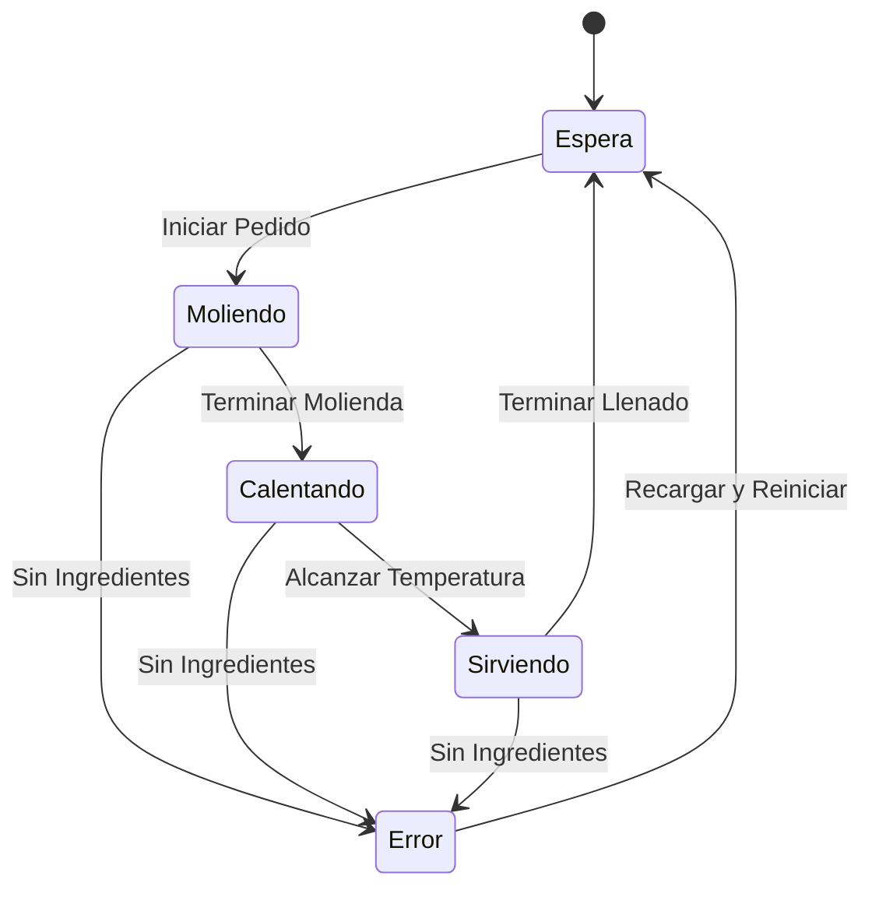

# Diseño de pruebas y decisiones de alcance

## Fuentes

- Taller Automatización pruebas backend con Karate framework.pdf, páginas 2 y 6: exactamente un ejercicio de cada bloque; al menos 10 escenarios con issues, Actions y trazabilidad.
- Guia Karate framework v3.pdf: estructura, Karate 1.4.1, reportes y resultados en issues.
- TALLER DE TÉCNICAS DE PRUEBA DE CAJA NEGRA – Parte 2.pdf, encontrado en el ZIP de materiales de clase: reglas de Climatización (páginas 1–2) y Barista (páginas 4–5).
- Definiciones públicas de la API, consultadas el 15 de octubre de 2026; copias de lectura en `materiales/`. Estas fijan nombres de campos y eventos; los resultados esperados se basan en las reglas de negocio, no se aprenden de la respuesta evaluada.

## Barista Bot: requisitos

| ID | Regla |
|---|---|
| BAR-01 | En Espera + Iniciar Pedido → Moliendo |
| BAR-02 | Moliendo + Terminar Molienda → Calentando Agua |
| BAR-03 | Calentando Agua + Alcanzar Temperatura → Sirviendo |
| BAR-04 | Sirviendo + Terminar Llenado → En Espera |
| BAR-05 | Sin Ingredientes en cualquiera de los tres estados activos → Error de Insumos; interrumpir flujo |
| BAR-06 | Error de Insumos + Recargar y Reiniciar → En Espera; restaurar servicio |
| BAR-07 | Cualquier otro par estado/evento no definido se rechaza y conserva el estado |

### Matriz completa: destino esperado

`—` significa transición inválida, conservando el estado de la fila.

| Estado inicial | Iniciar Pedido | Terminar Molienda | Alcanzar Temperatura | Terminar Llenado | Sin Ingredientes | Recargar y Reiniciar |
|---|---|---|---|---|---|---|
| En Espera | Moliendo | — | — | — | — | — |
| Moliendo | — | Calentando Agua | — | — | Error de Insumos | — |
| Calentando Agua | — | — | Sirviendo | — | Error de Insumos | — |
| Sirviendo | — | — | — | En Espera | Error de Insumos | — |
| Error de Insumos | — | — | — | — | — | En Espera |

TC01–TC08 cubren las ocho transiciones válidas. TC09–TC13 son cinco outlines, uno por estado, con 5, 4, 4, 4 y 5 ejemplos: 22 transiciones inválidas. Total: 30/30 celdas.

El helper reinicia, verifica En Espera, recorre eventos conocidos y consulta el estado solicitado antes del evento bajo prueba. Después del evento se verifica la respuesta y el estado persistido mediante GET. En los negativos también se comprueba el último registro del historial.

## Climatización: tabla de decisión

Orden del payload `valores`: temperatura >26°C (T), presencia humana (P), puertas/ventanas abiertas >3 minutos (V).

| Caso | T | P | V | Acción esperada | Requisito |
|---|---|---|---|---|---|
| TC14 | F | F | F | Mantener apagado | CLI-04 |
| TC15 | F | F | V | Apagar y emitir alerta | CLI-01 |
| TC16 | F | V | F | Mantener apagado | CLI-04 |
| TC17 | F | V | V | Apagar y emitir alerta | CLI-01 |
| TC18 | V | F | F | Bajo consumo | CLI-03 |
| TC19 | V | F | V | Apagar y emitir alerta | CLI-01 |
| TC20 | V | V | F | Refrigeración | CLI-02 |
| TC21 | V | V | V | Apagar y emitir alerta | CLI-01 |

CLI-01 tiene prioridad absoluta. Las ocho combinaciones cubren cuatro reglas simplificadas (índices 0–3). TC22/CLI-05 agrega cinco comprobaciones de rechazo estructural observado: campo ausente, lista vacía, dos valores, cuatro valores y null; se espera HTTP 400. Estas comprobaciones adicionales no se atribuyen al enunciado funcional de la profesora.

La revisión del 16 de octubre retiró únicamente el ejemplo `[true, "si", false]`. La expectativa de HTTP 400 para un elemento de otro tipo no tenía una especificación independiente: los materiales describen reglas sobre condiciones booleanas, y la página pública solo envía valores de casillas de selección. Eso no define la política de errores para texto. Se conserva la reproducción histórica como observación exploratoria en [DEFECTOS.md](DEFECTOS.md). No se sustituyó la aserción por 200 ni se agregó un `ignore`; se corrigió el alcance de la regresión, de 44 a **43 ejecuciones**. La cobertura funcional permanece en 30/30 pares estado/evento y 8/8 combinaciones.

## Ambigüedades y límites resueltos

1. **Estados activos:** Moliendo, Calentando Agua y Sirviendo. En Espera y Error de Insumos no son activos; Sin Ingredientes en esos dos estados es inválido.
2. **Recargar y Reiniciar frente a /reiniciar:** el primero es un evento de negocio desde Error de Insumos; el endpoint de reinicio es una facilidad de preparación del entorno y no se cuenta como transición adicional.
3. **Errores de negocio y HTTP:** en Barista, 200 no significa transición válida. Se exige `valida` y el estado apropiado. La API marca las transiciones rechazadas con `noDefinida: true`.
4. **Acciones de Barista:** el contrato devuelve `accion: null` en las cuatro transiciones del ciclo; para error y recuperación expone Interrumpir flujo/Restaurar servicio. Las acciones se validan explícitamente.
5. **Umbrales numéricos:** Climatización solo acepta las tres condiciones booleanas ya evaluadas; no se simulan pruebas de 26°C ni 3 minutos como si la API recibiera esos números.
6. **Entradas malformadas:** CLI-05 identifica comprobaciones adicionales del rechazo estructural observado, separadas de las cuatro reglas funcionales originales. No se interpreta una observación como especificación de todos los tipos de entrada.
7. **Estado compartido:** no se afirma aislamiento entre distintos usuarios de la API; se serializan nuestras pruebas y se documenta la limitación.

Los casos negativos de las reglas de negocio se conservan completos. La reducción documentada de un ejemplo responde a una expectativa sin fuente, no a cambiar el resultado esperado para copiar una respuesta de la API.
